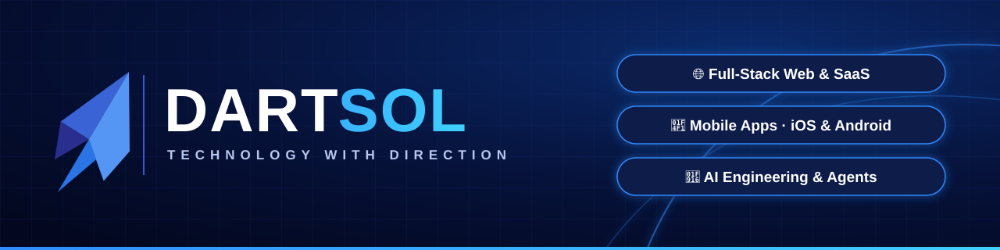

<p align="center">
  
</p>

<p align="center">
  <a href="https://github.com/jawadcr7">
    
  </a>
</p>

<p align="center">
  
  
  
  
  
</p>

---

## 👨‍💻 About me

```yaml
name:      Muhammad Jawad Zia
role:      CTO @ Dartsol
focus:     [Full-Stack Web, Mobile Apps, AI Engineering]
building:  Idea → MVP → launch → scale
approach:  Clean code, fast delivery, clear updates
open_to:   Freelance & contract work worldwide
```

As **CTO of Dartsol**, I lead our technical direction: system architecture, the tech stack, and delivery across web, mobile and AI projects. I also stay hands-on as an engineer. I build full-stack platforms and cross-platform mobile apps, and I integrate AI (LLM agents, RAG and automation) into real products.

---

## 🚀 About Dartsol

<table>
  <tr>
    <td width="62%" valign="top">

**Dartsol** is a software company that builds web, mobile and AI products for startups and businesses. Our tagline is ***Technology with Direction***. Every product we ship starts with a clear goal and a solid technical plan, and ends with software that's ready for real users.

**What Dartsol delivers:**

- 🌐 **Web platforms & SaaS**: dashboards, CRMs, portals, APIs
- 📱 **Mobile apps**: cross-platform iOS & Android with Flutter and React Native
- 🤖 **AI solutions**: chatbots, AI agents, RAG over company data, workflow automation
- 🎬 **AI content automation**: script → AI video → published to social platforms

**How we work:** discovery → design → build in sprints → launch → support

  </td>
    <td width="38%" valign="top" align="center">
      <br/>
      
      <br/><br/>
      <sub>Idea → Product → Growth</sub>
    </td>
  </tr>
</table>

---

## 🛠️ Tech stack

<table>
  <tr>
    <td align="center" width="140"><b>Frontend</b></td>
    <td></td>
  </tr>
  <tr>
    <td align="center"><b>Backend</b></td>
    <td></td>
  </tr>
  <tr>
    <td align="center"><b>Mobile</b></td>
    <td><br/><sub>Flutter · React Native · iOS · Android</sub></td>
  </tr>
  <tr>
    <td align="center"><b>Databases</b></td>
    <td></td>
  </tr>
  <tr>
    <td align="center"><b>AI / LLM</b></td>
    <td>
      
      
      
      
      
    </td>
  </tr>
  <tr>
    <td align="center"><b>DevOps & Tools</b></td>
    <td></td>
  </tr>
</table>

---

## 📌 Featured projects

<table>
  <tr>
    <td width="50%" valign="top">
      <h3>🤖 <a href="https://github.com/jawadcr7/langgraph-memory-chatbot">LangGraph Memory Chatbot</a></h3>
      <p>ChatGPT-style AI chatbot with multiple conversation threads, persistent SQLite memory and real-time streaming responses.</p>
      
      
      
      
    </td>
    <td width="50%" valign="top">
      <h3>🔎 <a href="https://github.com/jawadcr7/agentic-rag-assistant">Agentic RAG Assistant</a></h3>
      <p>Chat with your PDFs and websites. An LLM checks whether the documents can answer, and the app falls back to web search when they can't.</p>
      
      
      
      
    </td>
  </tr>
  <tr>
    <td width="50%" valign="top">
      <h3>🎬 AI Video Automation <sub><i>(coming soon)</i></sub></h3>
      <p>End-to-end pipeline: script → AI-generated video → rendering → auto-publishing to YouTube, TikTok and Instagram.</p>
      
      
      
    </td>
    <td width="50%" valign="top">
      <h3>📱 Mobile & Web Apps <sub><i>(coming soon)</i></sub></h3>
      <p>Flutter, React Native and full-stack projects built at Dartsol. Public demo versions are on the way.</p>
      
      
      
    </td>
  </tr>
</table>

<!-- GitHub stats: uncomment after about a month of commits (on a new account they show zeros)
---

## 📊 GitHub activity

<p align="center">
  
  
</p>
<p align="center">
  
</p>
-->

---

## 🤝 Let's work together

<p align="center">
  <b>Need a web app, mobile app or AI feature built? Let's build it together.</b><br/><br/>
  <a href="https://github.com/jawadcr7?tab=repositories"></a>
  <!-- Add your links by removing the comment marks around each badge:
  <a href="UPWORK_PROFILE_URL"></a>
  <a href="LINKEDIN_URL"></a>
  <a href="mailto:YOUR_EMAIL"></a>
  <a href="DARTSOL_WEBSITE_URL"></a>
  -->
</p>

<p align="center">
  
</p>
